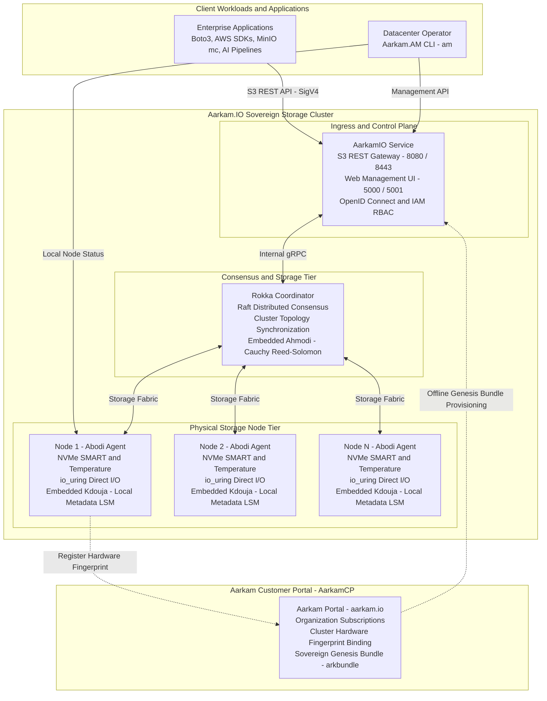

# Aarkam Sovereign Object Storage Platform (`Aarkam.IO`)
### High-Performance, Distributed, Air-Gapped Object Storage Infrastructure
**Official Customer Portal (AarkamCP)**: [https://aarkam.io/](https://aarkam.io/)  
**License**: [Aarkam Commercial Enterprise Sovereign License (ASCEL-v1.0)](LICENSE)  
**Current Release**: `V1.0.0-Beta` ([Release Notes](Releases/V1.0.0-Beta/RELEASE_NOTES.md))

---

## 1. Overview

# Aarkam — Sovereign Distributed Object Storage

**Aarkam** is an autonomous, distributed, ultra-high-throughput object storage platform engineered for mission-critical sovereign clouds, defense installations, national banking grids, and air-gapped enterprise datacenters.

Operating with **zero external telemetry egress** and **zero internet dependencies**, Aarkam combines Cauchy Reed-Solomon erasure coding with S3-compatible APIs using AWS Signature Version 4 (SigV4).

## Architecture Overview



## Core Components

- **AarkamIO** — Application ingress, S3-compatible REST API, management UI, and identity integration.
- **Rokka** — Distributed coordination, Raft consensus, and storage-cluster topology management.
- **Ahmodi** — Hardware-accelerated Cauchy Reed-Solomon erasure coding.
- **Abodi** — Storage-node agent responsible for node-level storage operations and hardware monitoring.
- **Kdouja** — Local metadata storage engine.
- **AarkamCP** — Customer portal for subscriptions, hardware fingerprint binding, and Genesis Bundle provisioning.

## Sovereign Deployment Model

Aarkam is designed to operate within customer-controlled infrastructure, including isolated and air-gapped environments. Initial provisioning can use an approved offline transfer mechanism to import the Genesis Bundle into the target cluster.

The customer portal is not required to remain reachable during normal storage operations in a properly provisioned offline deployment.

## Design Objectives

- Data sovereignty and customer-controlled infrastructure.
- No mandatory external telemetry or runtime internet dependency.
- Distributed storage with erasure coding.
- S3-compatible application integration using SigV4.
- Local metadata and storage-node management.
- Offline provisioning for isolated environments.
- Centralized cluster coordination and topology management.

*Architecture diagram represents the logical design; deployment-specific connectivity and component capabilities depend on the implemented configuration.*


---

## 2. Core Ecosystem Architecture

The platform distribution is decoupled into dedicated, modular components located under `Releases/V1.0.0-Beta/`:

| Component | Role | Embedded Core Engine | Deployment Scope |
| :--- | :--- | :--- | :--- |
| **`AarkamIO`** | Central Control Plane & S3 REST Gateway | AspNetCore 10 Web Engine | Gateway / Management nodes fronting the cluster. |
| **`Rokka`** | Distributed Storage & Consensus Coordinator | **`Ahmodi`** (Cauchy Reed-Solomon Erasure Coding Engine) | Deployed on 3 or 5 quorum consensus nodes. |
| **`Abodi`** | Real-Time Node Telemetry & Hardware Profiler | **`Kdouja`** (Zero-Copy LSM Metadata Engine) | Deployed as a background daemon on **every** physical storage node. |
| **`Aarkam.AM`** | Aarkam Manager (`am` / `am.exe`) Operator CLI | Core Diagnostics & Cluster Orchestrator | Installed on operator workstations and bastion servers. |

> [!SECURITY]
> **No License Generator Tooling in Client Releases**:  
> In adherence to sovereign defense standards, **license generation tooling is strictly internal to Aarkam HQ**. Enterprise licenses and Genesis ceremony bundles (`.arkbundle`) are generated exclusively via the official **Aarkam Customer Portal** at **[https://aarkam.io/](https://aarkam.io/)**.

---

## 3. Official Documentation Suite

Comprehensive technical runbooks, hardware specifications, and disaster recovery procedures are available in the [`docs/`](docs/) directory:

| Document | Title & Focus Area | Target Audience |
| :--- | :--- | :--- |
| [`01_COMPREHENSIVE_REQUIREMENTS_MATRIX.md`](docs/01_COMPREHENSIVE_REQUIREMENTS_MATRIX.md) | Node, Cluster, and AarkamIO Hardware & Kernel Specifications | Infrastructure Architects & SREs |
| [`02_PORTS_AND_NETWORK_FIREWALL_MATRIX.md`](docs/02_PORTS_AND_NETWORK_FIREWALL_MATRIX.md) | Network Zones, MTU 9000, Protocols & Firewall Rules (ufw/firewalld) | Network & Security Engineers |
| [`03_STORAGE_AND_DRIVE_INFRASTRUCTURE_GUIDE.md`](docs/03_STORAGE_AND_DRIVE_INFRASTRUCTURE_GUIDE.md) | NVMe, Enterprise SSD, SAS HDD, 4Kn Sectors & IT-Mode Controller Runbook | Datacenter Operators & Storage Techs |
| [`04_END_TO_END_INSTALLATION_AND_ACTIVATION_SEQUENCE.md`](docs/04_END_TO_END_INSTALLATION_AND_ACTIVATION_SEQUENCE.md) | Complete Deployment, Hardware Fingerprinting & AarkamCP Genesis Activation | Systems Administrators & DevOps |
| [`05_CTO_SOVEREIGN_ARCHITECTURE_AND_COMPLIANCE_SPEC.md`](docs/05_CTO_SOVEREIGN_ARCHITECTURE_AND_COMPLIANCE_SPEC.md) | Durability Math (11 9s), TCO Analysis vs Cloud, and Regulatory Compliance (NDMO/NCA/SAMA) | CTOs, CISOs, Chief Architects |
| [`06_COO_OPERATIONS_DISASTER_RECOVERY_RUNBOOK.md`](docs/06_COO_OPERATIONS_DISASTER_RECOVERY_RUNBOOK.md) | Business Continuity (RPO=0 / RTO<5s), Fault Domains, and Multi-DC DR | COOs, VP Ops, Incident Commanders |
| [`07_APPLICATION_SUPPORT_AND_S3_SDK_GUIDE.md`](docs/07_APPLICATION_SUPPORT_AND_S3_SDK_GUIDE.md) | S3 API SigV4, Multipart Uploads, and SDK Code Samples (Python, Go, C#, Node) | Application Support & Developers |

---

## 4. Quickstart Deployment Guide

### Step 4.1: Deploy Storage Services
```bash
# 1. On every storage node: Start Abodi (with embedded Kdouja)
cd Releases/V1.0.0-Beta/Abodi
dotnet Abodi.dll --urls "http://0.0.0.0:9400"

# 2. On quorum coordinator nodes: Start Rokka (with embedded Ahmodi)
cd Releases/V1.0.0-Beta/Rokka
dotnet Rokka.Coordinator.dll --urls "https://0.0.0.0:9100"

# 3. On gateway node: Start AarkamIO Control Plane & S3 Gateway
cd Releases/V1.0.0-Beta/AarkamIO
dotnet Aarkam.dll --urls "https://0.0.0.0:5001;http://0.0.0.0:5000"
```

### Step 4.2: Retrieve Hardware Fingerprint
Open your browser and navigate to:
```text
https://<node-ip>:5001/genesis
```
Copy the generated **Cluster Hardware Fingerprint** (`ARK-FP-...`).

### Step 4.3: Mint Genesis Bundle on AarkamCP ([https://aarkam.io/](https://aarkam.io/))
1. Log into **[https://aarkam.io/](https://aarkam.io/)** and open **Administration -> Current Subscription**.
2. Click **Bind Fingerprint** and paste your `ARK-FP-...` token with your cluster code.
3. Click **Genesis** to download `Aarkam-Genesis-<ClusterCode>.arkbundle`.
   - *Paid subscriptions* unlock full PB-scale storage, enterprise nodes, and SixFM AI.
   - *Unpaid / Evaluation accounts* receive a Beta bundle constrained to 3 nodes, 5 TB capacity, and SixFM disabled.

### Step 4.4: Seal the Cluster
1. Upload `.arkbundle` to `https://<node-ip>:5001/genesis`.
2. Enter your root master password (salted and hashed locally using PBKDF2 SHA-256).
3. The cluster verifies the 8-layer anti-hacking audit, locks the state (`IsBootstrapped = true`), and redirects to `/login`.

---

## 5. Using the Aarkam Manager (AM) CLI

The standalone CLI binary `am` (located in `Releases/V1.0.0-Beta/Aarkam.AM/`) enables direct command-line administration:

```bash
# Check cluster status and consensus leaders
./am cluster status

# Inspect physical disk health across all storage nodes
./am disk list

# Gracefully drain a degraded disk prior to hot-swap
./am disk drain /dev/nvme2n1
```

---

## 6. S3 Client Verification (AWS CLI)

```bash
# Configure standard S3 environment
export AWS_ACCESS_KEY_ID="AKIA_PROD_APP01"
export AWS_SECRET_ACCESS_KEY="SEC_KEY_PROD_SECRET_XYZ"
export AWS_ENDPOINT_URL="https://<node-ip>:8443"

# Create bucket and upload file
aws --endpoint-url $AWS_ENDPOINT_URL --no-verify-ssl s3 mb s3://sovereign-vault
aws --endpoint-url $AWS_ENDPOINT_URL --no-verify-ssl s3 cp document.pdf s3://sovereign-vault/
aws --endpoint-url $AWS_ENDPOINT_URL --no-verify-ssl s3 ls s3://sovereign-vault/
```

---

## 7. Commercial Licensing & Enterprise Support

Aarkam is licensed under the [Aarkam Commercial Enterprise Sovereign License (ASCEL-v1.0)](LICENSE).

- **Customer Operations & Licensing Portal**: [https://aarkam.io/](https://aarkam.io/)
- **Technical Support Portal**: [https://aarkam.io/Administration/TehcnicalSupport](https://aarkam.io/Administration/TehcnicalSupport)
- **Enterprise Sales & Custom Deployments**: [enterprise@aarkam.io](mailto:enterprise@aarkam.io)

---
*(c) 2026 Aarkam Inc. All Rights Reserved. Sovereign Distributed Storage Infrastructure.*
