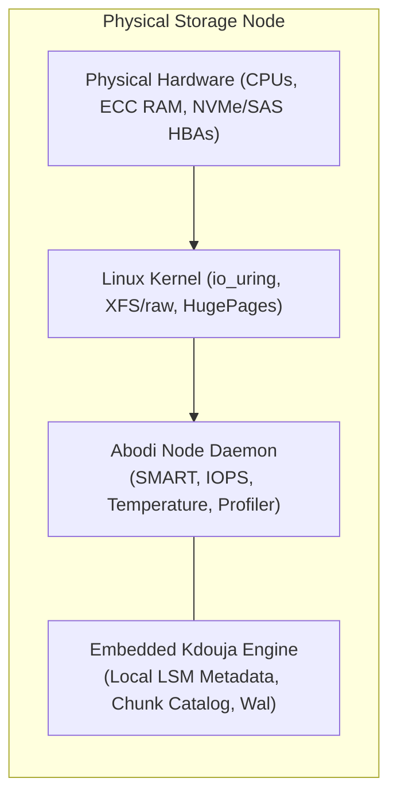
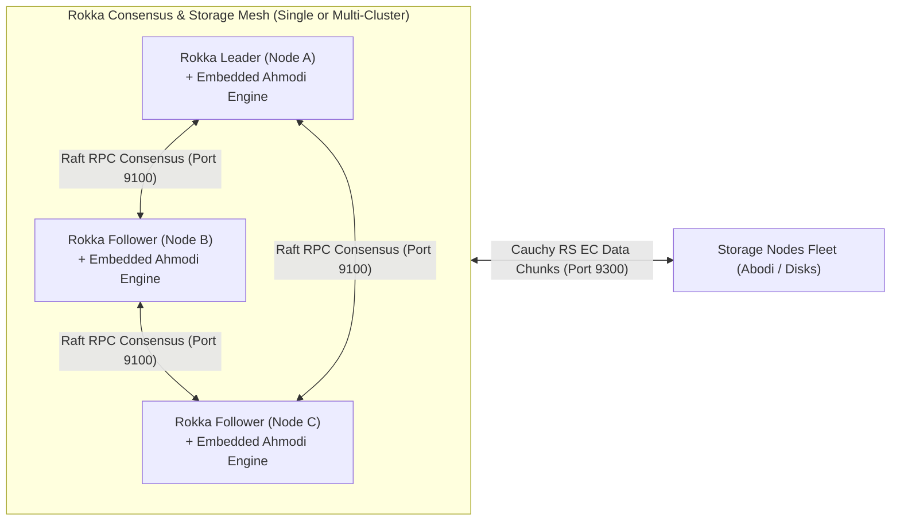

# Aarkam.IO Sovereign Storage Platform — Comprehensive Requirements Matrix
## Infrastructure, Node, Cluster & Control Plane Specifications
**Target Audience**: Infrastructure Architects, Hardware Engineers, Datacenter Operators, and Systems Administrators  
**Customer Portal (AarkamCP)**: [https://aarkam.io/](https://aarkam.io/)

---

## 1. Architectural Architecture Overview

The Aarkam platform consists of three primary operational tiers:
1. **Physical Storage Node Tier (`Abodi` Daemon)**: Runs on every physical server hosting disks. Hosts hardware telemetry, SMART health monitoring, and embeds the **`Kdouja`** local metadata and transaction engine.
2. **Cluster Coordination & Storage Tier (`Rokka` Coordinator)**: Runs across a quorum of nodes (3 or 5 minimum). Coordinates Raft distributed consensus, cluster topology, and embeds **`Ahmodi`** Cauchy Reed-Solomon chunk erasure coding engine.
3. **Control & S3 Gateway Tier (`AarkamIO`)**: Front-end ingress layer providing the AWS S3-compatible REST API, web management UI, and cluster governance.

---

## 2. Storage Node Tier Requirements (`Abodi` + Embedded `Kdouja`)

The **Abodi** daemon executes on each physical storage node, interfacing directly with storage controllers and block devices. It embeds the **Kdouja** high-speed key-value and metadata engine.



### 2.1 Hardware Specifications per Node

| Hardware Component | Minimum Specification (Evaluation / Edge) | Recommended Specification (Enterprise Production) | Mission-Critical Specification (Hyperscale Cloud) |
| :--- | :--- | :--- | :--- |
| **Processor (CPU)** | 8 Cores (x86_64 or ARM64) with SSE4.2 | 16–32 Cores with **AVX-512** support (Intel Xeon Scalable 4th Gen+ / AMD EPYC 9004+) | Dual-Socket AMD EPYC Bergamo / Genoa (64–128 Cores) |
| **System Memory (RAM)** | 32 GB ECC DDR4 | 128 GB ECC DDR5 (Registered RDIMM) | 256 GB–512 GB ECC DDR5 per Node |
| **Boot Storage** | 2x 240 GB SATA SSD (RAID-1 Mirror) | 2x 480 GB Enterprise NVMe M.2 (RAID-1 Hardware Mirror) | 2x 960 GB Enterprise M.2 NVMe with Power Loss Protection (PLP) |
| **Data Drives (Storage)** | 4x SAS/SATA Enterprise Disks | 8x–24x Enterprise U.2/U.3 NVMe SSDs (TLC/QLC) | 24x–48x PCIe 5.0 Enterprise NVMe SSDs per Chassis |
| **Storage Controller** | SAS 12Gbps HBA in strict **IT Mode** | Direct PCIe Bifurcated NVMe Switch Backplane | Direct Gen5 NVMe Switch Backplane with hot-plug support |
| **Network Interfaces** | 2x 10 GbE SFP+ (LACP Bond) | 2x 25 GbE / 100 GbE QSFP28 (RoCEv2 RDMA Capable) | 4x 100 GbE / 200 GbE Dual Redundant Spine-Leaf Fabrics |
| **Hardware Security** | TPM 2.0 Module | TPM 2.0 + Dedicated PCIe HSM / Cryptographic Offload | TPM 2.0 + Dedicated PCIe HSM with Post-Quantum Key Store |

### 2.2 Operating System & Kernel Configuration

- **Supported Operating Systems**:
  - Ubuntu Server 24.04 LTS (Kernel 6.8+) — *Tier-1 Recommended*
  - Ubuntu Server 22.04 LTS (Kernel 5.15+)
  - RHEL 9.2+ / Rocky Linux 9.2+ (Kernel 5.14+)
  - Windows Server 2022 / 2025 (NT 10.0+)
- **Storage Subsystem Requirements**:
  - `io_uring` support enabled in kernel (`CONFIG_IO_URING=y`).
  - Native asynchronous I/O (`libaio1` / `liburing2`).
  - Filesystem: **XFS** formatted with `mkfs.xfs -m crc=1,reflink=1 -b size=4096` or raw unformatted block partitions for Ahmodi direct chunk writes.
  - Mount flags: `noatime,nodiratime,logbufs=8,logbsize=256k,allocsize=64M`.
- **Kernel Tunables (`/etc/sysctl.d/99-aarkam-node.conf`)**:
  ```ini
  # File Descriptors & Process Limits
  fs.file-max = 2097152
  fs.aio-max-nr = 1048576
  vm.max_map_count = 1048576

  # Virtual Memory Management
  vm.swappiness = 1
  vm.dirty_background_ratio = 5
  vm.dirty_ratio = 10

  # High-Throughput Network Fabric
  net.core.somaxconn = 65535
  net.core.netdev_max_backlog = 16384
  net.core.rmem_max = 67108864
  net.core.wmem_max = 67108864
  net.ipv4.tcp_rmem = 4096 87380 67108864
  net.ipv4.tcp_wmem = 4096 65536 67108864
  net.ipv4.tcp_window_scaling = 1
  net.ipv4.tcp_slow_start_after_idle = 0
  ```

---

## 3. Cluster Coordination & Storage Requirements (`Rokka` + Embedded `Ahmodi`)

**Rokka** governs distributed consensus, leader election, chunk placement, and cluster quorum. It directly embeds the **Ahmodi** Cauchy Reed-Solomon erasure coding and reconstruction engine.



### 3.1 Cluster Topologies & Node Count Requirements

| Cluster Topology | Minimum Quorum Nodes | Fault Tolerance | Ahmodi EC Profile | Target Use Case |
| :--- | :--- | :--- | :--- | :--- |
| **Starter Sovereign Pod** | **3 Nodes** | Tolerates 1 Node Failure | Ahmodi 2+1 (33% parity overhead) | Small Datacenter / Branch Office |
| **Enterprise Standard Cluster** | **5 Nodes** | Tolerates 2 Node Failures | Ahmodi 4+2 (50% parity overhead) | Enterprise Primary Datacenter |
| **Hyperscale Multi-Chassis** | **8–32 Nodes** | Tolerates 4 Node Failures | Ahmodi 8+4 (50% parity overhead) | Sovereign National Cloud / Telco |
| **Geo-Distributed Multi-Cluster** | **3 Datacenters (2+1)** | Tolerates Entire DC Outage | Cross-DC Asynchronous Mirroring | Disaster Recovery / Zero Data Loss |

### 3.2 Network Fabric Requirements between Clusters

- **Intra-Cluster Latency**:
  - Maximum round-trip time (RTT): $\le 1.0\text{ ms}$ (Recommended: $< 200\ \mu\text{s}$).
  - Zero packet drop on cluster fabric.
- **Inter-Cluster / Multi-DC Latency (Asynchronous Replication)**:
  - Maximum RTT: $\le 30.0\text{ ms}$.
- **MTU Configuration**:
  - Mandatory **Jumbo Frames (MTU 9000)** on storage and consensus fabrics.
- **Bandwidth**:
  - Minimum: 10 Gbps dedicated full-duplex per node.
  - Recommended: 25 Gbps / 100 Gbps RoCEv2 (RDMA over Converged Ethernet) with PFC (Priority Flow Control).

---

## 4. Control Plane & S3 Gateway Requirements (`AarkamIO`)

The **AarkamIO** tier hosts the AWS S3-compatible REST API engine, web administration console, customer certificate management, and OpenID Connect identity provider.

### 4.1 System Specifications for Gateway Nodes

| Component | Minimum Specification | Recommended Specification |
| :--- | :--- | :--- |
| **Node Placement** | Dedicated Gateway VM/Server or Co-located with Rokka Leader | Dedicated Gateway Tier fronted by HAProxy / F5 / BGP Anycast |
| **CPU** | 8 Cores (High single-thread frequency) | 16–32 Cores (Optimized for TLS encryption and SigV4 hashing) |
| **Memory** | 16 GB ECC RAM | 64 GB ECC RAM (Buffered streaming for multipart S3 transfers) |
| **Local Cache** | 100 GB NVMe (Temporary multipart staging & metadata cache) | 500 GB–1 TB Enterprise NVMe (High-speed cache) |
| **Network** | 2x 10 GbE Bonded (Public S3 Ingress + Private Storage Fabric) | 2x 25 GbE or 2x 100 GbE Bonded |

### 4.2 Database & Persistence Requirements

- **Supported State Store**:
  - **Embedded SQLite with WAL Mode**: Pre-configured for standalone and single-pod deployments with zero external dependencies.
  - **PostgreSQL 15+**: Supported for enterprise high-availability control plane configurations.
- **Connection Prerequisites**:
  - Minimum pool size: 50 connections.
  - SSL mode: `Require` or `Verify-Full`.

---

## 5. Summary Hardware Sizing Calculator

$$\text{Usable Capacity} = \text{Raw Drive Capacity} \times \left( \frac{K}{K + M} \right) \times 0.90$$

*Where:*
- $K$ = Data Chunks (e.g., 4 in Ahmodi 4+2)
- $M$ = Parity Chunks (e.g., 2 in Ahmodi 4+2)
- $0.90$ = Filesystem reserve and metadata overhead factor

*Example: 24 Nodes with 10x 15.36 TB NVMe per node = 3,686.4 TB Raw.*  
*With Ahmodi 8+4 ($K=8, M=4$):*
$$\text{Usable Capacity} = 3686.4 \times \left( \frac{8}{12} \right) \times 0.90 \approx 2,211.84\text{ TB Usable (2.21 PB)}$$

---
*(c) 2026 Aarkam Sovereign Object Storage Platform. All Rights Reserved.*
