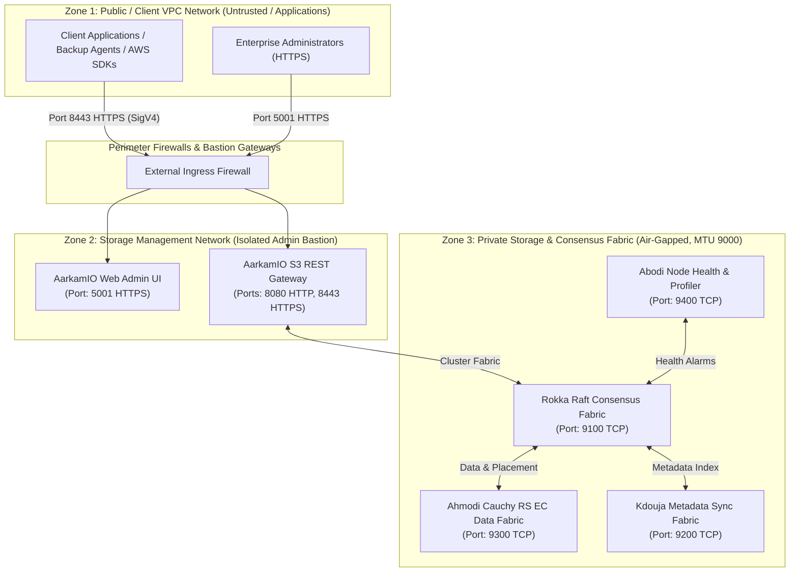

# Aarkam.IO Sovereign Storage Platform — Ports, Networking & Firewall Matrix
## Network Segmentation, Port Specifications & Firewall Rules Runbook
**Target Audience**: Network Engineers, Datacenter Security Teams, Firewall Administrators  
**Customer Portal (AarkamCP)**: [https://aarkam.io/](https://aarkam.io/)

---

## 1. Network Topology & Zoning Architecture

Aarkam enterprise deployments strictly enforce a **Multi-Zone Defense-in-Depth Network Model**:



---

## 2. Complete Ports & Protocol Matrix

| Port | Protocol | Traffic Direction | Source Zone | Destination Zone | Service / Component | Purpose & Description | Security & Encryption |
| :--- | :--- | :--- | :--- | :--- | :--- | :--- | :--- |
| **5000** | TCP | Inbound | Admin Bastion / Internal | AarkamIO Gateway | AarkamIO Web Console | Cleartext Web UI (Auto-redirects to 5001 in production) | HTTP (Redirect only) |
| **5001** | TCP | Inbound | Admin Bastion / SecOps | AarkamIO Gateway | AarkamIO Web Console | Secure Management UI, REST Admin API, and `/genesis` ceremony wizard | TLS 1.3 / AES-256-GCM |
| **8080** | TCP | Inbound | Client Applications / VPC | AarkamIO Gateway | S3 REST Gateway | Standard S3 REST API (SigV4 authenticated) | Cleartext HTTP (Internal VPC) |
| **8443** | TCP | Inbound | Client Applications / VPC | AarkamIO Gateway | S3 REST Gateway | Secure S3 REST API (SigV4 authenticated) | TLS 1.3 / AES-256-GCM |
| **9100** | TCP | Bi-directional | Rokka Quorum Nodes | Rokka Quorum Nodes | Rokka Coordinator | Raft consensus RPC, leader election, and heartbeat synchronization | mTLS / Internal gRPC |
| **9200** | TCP | Bi-directional | Storage Nodes (Abodi) | Storage Nodes (Abodi) | Embedded Kdouja | Distributed metadata state replication, LSM sync, and index broadcast | mTLS / High-speed binary |
| **9300** | TCP | Bi-directional | Storage Nodes (Rokka) | Storage Nodes (Abodi) | Embedded Ahmodi | Cauchy Reed-Solomon EC chunk transmission, replication & re-silvering | Direct TCP Streaming / RoCEv2 |
| **9400** | TCP | Bi-directional | Storage Nodes (Abodi) | Rokka Coordinator | Abodi Daemon | Real-time node telemetry, SMART disk alerts, IOPS metrics & health | mTLS / REST JSON |
| **9500** | TCP | Bi-directional | Gateway / Rokka | SixFM Nodes | SixFM Vector Fabric | High-speed semantic vector embeddings query fabric (Enterprise only) | mTLS / gRPC |
| **9090** | TCP | Inbound | Monitoring / Prometheus | All Nodes | Telemetry Exporter | Prometheus metrics scrape target (`/metrics`) | Token Authenticated HTTP |

---

## 3. Firewall Configuration Scripts

### 3.1 Ubuntu / Debian (`ufw`) Implementation

#### On Gateway Nodes (Hosting `AarkamIO`):
```bash
# Reset UFW
sudo ufw --force reset
sudo ufw default deny incoming
sudo ufw default allow outgoing

# Allow SSH from management bastion only
sudo ufw allow from 10.10.10.0/24 to any port 22 proto tcp comment 'Bastion SSH'

# Allow Ingress Web UI and S3 API Gateway
sudo ufw allow from 10.10.10.0/24 to any port 5001 proto tcp comment 'AarkamIO Admin UI'
sudo ufw allow from 172.16.0.0/12 to any port 8443 proto tcp comment 'AarkamIO S3 HTTPS'
sudo ufw allow from 172.16.0.0/12 to any port 8080 proto tcp comment 'AarkamIO S3 HTTP'

# Allow Communication with Storage Fabric (Internal Subnet 192.168.100.0/24)
sudo ufw allow from 192.168.100.0/24 to any port 9100:9400 proto tcp comment 'Aarkam Storage Fabric'

sudo ufw enable
```

#### On Storage Nodes (Hosting `Abodi` + `Rokka`):
```bash
sudo ufw --force reset
sudo ufw default deny incoming
sudo ufw default allow outgoing

# SSH management
sudo ufw allow from 10.10.10.0/24 to any port 22 proto tcp comment 'Bastion SSH'

# Storage Fabric Ports (Restricted to Storage Subnet 192.168.100.0/24 only)
sudo ufw allow from 192.168.100.0/24 to any port 9100 proto tcp comment 'Rokka Raft'
sudo ufw allow from 192.168.100.0/24 to any port 9200 proto tcp comment 'Kdouja Metadata'
sudo ufw allow from 192.168.100.0/24 to any port 9300 proto tcp comment 'Ahmodi Chunk Fabric'
sudo ufw allow from 192.168.100.0/24 to any port 9400 proto tcp comment 'Abodi Telemetry'

# Prometheus Metrics Scrape
sudo ufw allow from 10.10.20.50 to any port 9090 proto tcp comment 'Prometheus Server'

sudo ufw enable
```

---

### 3.2 RHEL / Rocky Linux (`firewalld`) Implementation

```bash
# Define dedicated storage zone
sudo firewall-cmd --permanent --new-zone=aarkam-fabric
sudo firewall-cmd --permanent --zone=aarkam-fabric --add-source=192.168.100.0/24

# Add storage fabric ports to private zone
sudo firewall-cmd --permanent --zone=aarkam-fabric --add-port=9100/tcp
sudo firewall-cmd --permanent --zone=aarkam-fabric --add-port=9200/tcp
sudo firewall-cmd --permanent --zone=aarkam-fabric --add-port=9300/tcp
sudo firewall-cmd --permanent --zone=aarkam-fabric --add-port=9400/tcp

# Public / Ingress zone on Gateway Nodes
sudo firewall-cmd --permanent --zone=public --add-port=5001/tcp
sudo firewall-cmd --permanent --zone=public --add-port=8443/tcp
sudo firewall-cmd --permanent --zone=public --add-port=8080/tcp

sudo firewall-cmd --reload
```

---

## 4. High-Performance MTU 9000 (Jumbo Frames) Configuration

High-throughput Cauchy Reed-Solomon chunk transfers and RDMA require **MTU 9000** across all storage interfaces and Top-of-Rack (ToR) switches.

### Linux Netplan Configuration (`/etc/netplan/01-storage-fabric.yaml`)
```yaml
network:
  version: 2
  renderer: networkd
  ethernets:
    enp4s0f0:
      dhcp4: no
      mtu: 9000
    enp4s0f1:
      dhcp4: no
      mtu: 9000
  bonds:
    bond0:
      interfaces: [enp4s0f0, enp4s0f1]
      addresses: [192.168.100.11/24]
      mtu: 9000
      parameters:
        mode: 802.3ad
        lacp-rate: fast
        mii-monitor-interval: 100
        transmit-hash-policy: layer3+4
```

Apply and verify:
```bash
sudo netplan apply
# Verify MTU 9000 end-to-end ping without fragmentation
ping -M do -s 8972 192.168.100.12
```

---
*(c) 2026 Aarkam Sovereign Object Storage Platform. All Rights Reserved.*
