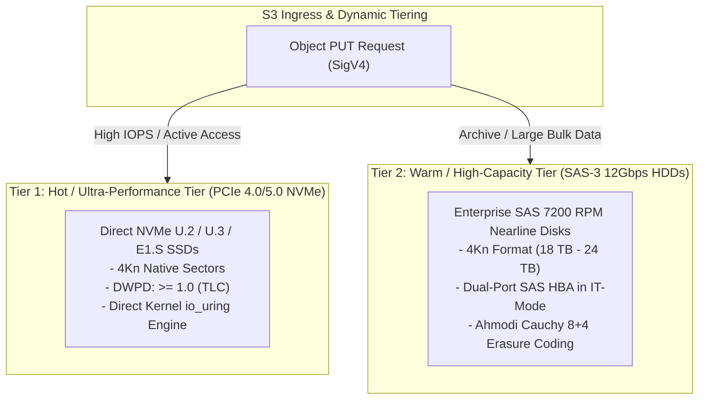
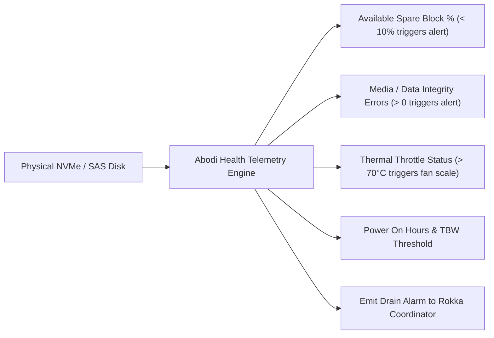

# Aarkam.IO Sovereign Storage Platform — Storage & Drive Infrastructure Guide
## NVMe, Enterprise SSD, and SAS HDD Architecture & Maintenance Runbook
**Target Audience**: Client Infrastructure Engineers, Datacenter Storage Operators, Hardware Support Specialists  
**Customer Portal (AarkamCP)**: [https://aarkam.io/](https://aarkam.io/)

---

## 1. Storage Tier Selection Matrix

The Aarkam platform supports multi-tiered storage configurations combining high-throughput PCIe NVMe tiers with cost-optimized SAS HDD capacity tiers:



---

## 2. Drive Architecture & Controller Specifications

### 2.1 Storage Controller Mode: Strict IT-Mode (Non-RAID)

> [!CAUTION]
> **Hardware RAID Controllers are Strictly Prohibited for Data Disks.**  
> All storage controllers (LSI / Broadcom / Microchip / Dell PERC) must be flashed to **Initiator Target (IT) Mode**.
>
> **Why Hardware RAID is Forbidden:**
> 1. **Erasure Coding Interference**: The embedded **Ahmodi** Cauchy Reed-Solomon engine manages mathematical parity and disk striping across independent failure domains. Hardware RAID creates nested striping that defeats Ahmodi's bit-rot self-healing.
> 2. **Double Caching & Cache Flush Hazards**: Controller write-cache conflicts with Linux kernel direct I/O (`O_DIRECT`), leading to silent corruption during power loss.
> 3. **SMART Visibility Blindspots**: RAID abstractions mask physical drive telemetry from **Abodi**, disabling predictive failure detection.

### 2.2 Sector Format: Native 4Kn vs 512e

| Sector Format | Status in Aarkam | Technical Recommendation & Rationale |
| :--- | :--- | :--- |
| **Native 4Kn (4096 bytes)** | **Mandatory Standard** | All enterprise NVMe and modern SAS HDDs (> 8 TB) must be formatted with native 4096-byte logical and physical sectors. Eliminates Read-Modify-Write (RMW) latency amplification. |
| **512e (512-byte Emulated)** | Supported (Legacy) | Permitted for legacy SATA drives, but results in a 15–25% throughput penalty under sustained high-concurrency writes due to sector alignment penalties. |
| **512n (512-byte Native)** | Deprecated | Not permitted for production storage tiers. |

To convert a 512e SAS drive to native 4Kn using `openSeaChest` or `sg_format`:
```bash
# Query drive sector size
sudo smartctl -i /dev/sdb | grep "Sector Size"

# Format to native 4096-byte sectors (DESTRUCTIVE - Erases all data)
sudo sg_format --format --size=4096 -v /dev/sdb
```

---

## 3. Flash Memory Endurance & Drive Selection Guidelines

### 3.1 Endurance Classifications (DWPD & TBW)

When selecting SSDs for the primary storage tier, operators must verify **Drive Writes Per Day (DWPD)** over a 5-year warranty lifecycle:

| Workload Profile | Flash Media Type | Minimum DWPD | Terabytes Written (TBW) Example (15.36 TB Drive) | Recommended Models |
| :--- | :--- | :--- | :--- | :--- |
| **Metadata & WAL Tier** | SLC / eTLC / Optane | $\ge 3.0\text{ DWPD}$ | $\ge 84,000\text{ TBW}$ | Kioxia CM7-V, Samsung PM1735, Solidigm D7-P5800X |
| **Hot Object Data Tier** | Enterprise TLC (BiCS5/V-NAND) | $\ge 1.0\text{ DWPD}$ | $\ge 28,000\text{ TBW}$ | Micron 7450 PRO, Solidigm D7-P5520, Kioxia CM7-R |
| **Capacity Archive Tier** | Enterprise QLC | $\ge 0.5\text{ DWPD}$ | $\ge 14,000\text{ TBW}$ | Solidigm D5-P5336 (30.72 TB / 61.44 TB) |

### 3.2 Power Loss Protection (PLP)
Every solid-state drive deployed in an Aarkam cluster **must feature Hardware Power Loss Protection (PLP)** via onboard tantalum capacitors. Non-enterprise consumer SSDs (lacking PLP) will drop inflight write journals during sudden datacenter power events, causing catastrophic filesystem failure.

---

## 4. Drive Failure Replacement & Hot-Swap Protocols

The **Abodi** daemon continuously reads SMART attributes and controller logs every 5 seconds. If an anomaly is detected, it raises a predictive failure alarm to **Rokka**.

### 4.1 Monitored SMART Telemetry Attributes



### 4.2 Standard Drive Replacement Runbook (Step-by-Step)

```bash
# Step 1: Identify the degraded disk via Abodi CLI or Web Console
# Example faulted drive: /dev/nvme2n1 (Serial: S67BNL0W123456)
am disk list --faulted

# Step 2: Trigger drive evacuation & graceful drain
# Rokka commands Ahmodi to re-silver active chunks to surviving nodes in the background
am disk drain /dev/nvme2n1 --force

# Step 3: Verify drive status transitions to 'SAFE_TO_REMOVE'
am disk status /dev/nvme2n1

# Step 4: Turn on physical chassis locator LED
sudo ledctl locate=/dev/nvme2n1

# Step 5: Physically extract the faulted drive from the hot-swap caddy and insert replacement disk

# Step 6: Turn off physical locator LED
sudo ledctl normal=/dev/nvme2n1

# Step 7: Initialize new replacement drive (formats XFS 4Kn & binds to Abodi)
am disk init /dev/nvme2n1 --tier hot

# Step 8: Ahmodi automatically rebalances chunks to restore full parity
am cluster scrub-status
```

---

## 5. Background Bit-Rot Scrubbing Schedules

Cauchy Reed-Solomon erasure coding provides mathematical protection against silent data corruption ("bit-rot"). The **Ahmodi** background scrub worker validates cryptographic SHA-256 chunk checksums periodically.

### Automated Scrub Schedule (`/opt/aarkam/config/scrub.json`)
```json
{
  "scrubbingPolicy": {
    "enabled": true,
    "scheduleCron": "0 2 * * 0",
    "throttling": {
      "maxReadIopsPerDisk": 250,
      "maxBandwidthMbPerSec": 75,
      "pauseDuringClientPeakHours": true,
      "peakHoursUtc": ["06:00-18:00"]
    },
    "autoRepair": {
      "enabled": true,
      "alertThresholdParityRecoveries": 3
    }
  }
}
```

- **Execution**: Runs every Sunday at 02:00 AM UTC.
- **Throttling**: Read IOPS capped at 250 to ensure zero impact on production client S3 PUT/GET latencies.
- **Self-Healing**: If a damaged bit is detected, Ahmodi uses the remaining Cauchy parity chunks to reconstruct the original data and writes it back to a healthy block.

---
*(c) 2026 Aarkam Sovereign Object Storage Platform. All Rights Reserved.*
