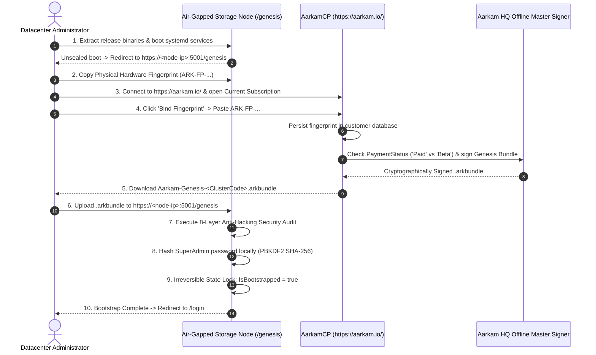

# Aarkam.IO Sovereign Storage Platform — End-to-End Installation & Activation Sequence
## Complete Operational Runbook: Node Deployment, Cluster Bootstrapping, and AarkamCP Genesis Activation
**Target Audience**: Systems Administrators, DevOps Engineers, Cloud Operations Teams  
**Official Aarkam Customer Portal (AarkamCP)**: [https://aarkam.io/](https://aarkam.io/)

---

## 1. High-Level Activation Lifecycle

Aarkam operates on a **Zero-Trust Sovereign Air-Gapped Lifecycle**:
- The software ships with **zero default accounts, zero seeded passwords, and zero external callbacks**.
- Initial root credential provisioning is cryptographically authorized via a single-use signed Genesis bundle.
- Licenses and genesis tokens are cryptographically bound to physical hardware signatures (`ARK-FP-...`).
- The **Aarkam Customer Portal (AarkamCP)** at **[https://aarkam.io/](https://aarkam.io/)** acts as the authorized external clearinghouse where organizations manage subscriptions and mint their cryptographic Genesis Ceremony bundles (`.arkbundle`).



---

## 2. Step 1: Pre-Flight Environment Preparation

Execute on all cluster nodes (Ubuntu Server 24.04 LTS / 22.04 LTS):

```bash
# 1. Update system packages
sudo apt update && sudo apt upgrade -y

# 2. Install core storage and networking prerequisites
sudo apt install -y liburing2 libaio1 xfsprogs smartmontools nvme-cli jq curl net-tools

# 3. Create dedicated system service account
sudo groupadd --system aarkam
sudo useradd --system --gid aarkam --shell /bin/false --no-create-home aarkam

# 4. Create standard directory layout
sudo mkdir -p /opt/aarkam/{bin,config,logs}
sudo mkdir -p /var/lib/aarkam/{data,metadata,wal}
sudo chown -R aarkam:aarkam /opt/aarkam /var/lib/aarkam
sudo chmod 750 /opt/aarkam /var/lib/aarkam
```

---

## 3. Step 2: Deploy Abodi Node Daemon (Every Storage Node)

The **Abodi** daemon runs on every physical host, providing real-time hardware health profiling and hosting the embedded **Kdouja** metadata engine.

1. Copy the `Abodi` release binaries to `/opt/aarkam/abodi/`:
   ```bash
   sudo cp -r /path/to/Releases/V1.0.0-Beta/Abodi/* /opt/aarkam/abodi/
   sudo chown -R aarkam:aarkam /opt/aarkam/abodi/
   ```

2. Create the systemd service `/etc/systemd/system/aarkam-abodi.service`:
   ```ini
   [Unit]
   Description=Aarkam Abodi Node Daemon & Hardware Health Agent
   After=network.target local-fs.target
   Wants=network-online.target

   [Service]
   Type=simple
   User=aarkam
   Group=aarkam
   WorkingDirectory=/opt/aarkam/abodi
   ExecStart=/usr/bin/dotnet /opt/aarkam/abodi/Abodi.dll --urls "http://0.0.0.0:9400"
   Restart=always
   RestartSec=5
   LimitNOFILE=1048576
   LimitMEMLOCK=infinity
   Environment=ASPNETCORE_ENVIRONMENT=Production

   [Install]
   WantedBy=multi-user.target
   ```

3. Enable and start the service:
   ```bash
   sudo systemctl daemon-reload
   sudo systemctl enable --now aarkam-abodi
   sudo systemctl status aarkam-abodi
   ```

---

## 4. Step 3: Deploy Rokka Storage & Consensus Coordinator

Deploy on the 3 or 5 quorum coordinator nodes. Rokka executes Raft consensus and coordinates the embedded **Ahmodi** Cauchy Reed-Solomon storage engine.

1. Copy `Rokka` release binaries to `/opt/aarkam/rokka/`:
   ```bash
   sudo cp -r /path/to/Releases/V1.0.0-Beta/Rokka/* /opt/aarkam/rokka/
   sudo chown -R aarkam:aarkam /opt/aarkam/rokka/
   ```

2. Create `/etc/systemd/system/aarkam-rokka.service`:
   ```ini
   [Unit]
   Description=Aarkam Rokka Consensus & Storage Coordinator
   After=network.target aarkam-abodi.service
   Requires=aarkam-abodi.service

   [Service]
   Type=simple
   User=aarkam
   Group=aarkam
   WorkingDirectory=/opt/aarkam/rokka
   ExecStart=/usr/bin/dotnet /opt/aarkam/rokka/Rokka.Coordinator.dll --urls "https://0.0.0.0:9100"
   Restart=always
   RestartSec=5
   LimitNOFILE=1048576
   Environment=ASPNETCORE_ENVIRONMENT=Production

   [Install]
   WantedBy=multi-user.target
   ```

3. Start Rokka:
   ```bash
   sudo systemctl daemon-reload
   sudo systemctl enable --now aarkam-rokka
   ```

---

## 5. Step 4: Deploy AarkamIO Control Plane & S3 Gateway

Deploy on the gateway nodes fronting the cluster.

1. Copy `AarkamIO` binaries to `/opt/aarkam/gateway/`:
   ```bash
   sudo cp -r /path/to/Releases/V1.0.0-Beta/AarkamIO/* /opt/aarkam/gateway/
   sudo chown -R aarkam:aarkam /opt/aarkam/gateway/
   ```

2. Create `/etc/systemd/system/aarkam-io.service`:
   ```ini
   [Unit]
   Description=Aarkam.IO Sovereign Storage Gateway & Web Console
   After=network.target aarkam-rokka.service

   [Service]
   Type=simple
   User=aarkam
   Group=aarkam
   WorkingDirectory=/opt/aarkam/gateway
   ExecStart=/usr/bin/dotnet /opt/aarkam/gateway/Aarkam.dll --urls "https://0.0.0.0:5001;http://0.0.0.0:5000"
   Restart=always
   RestartSec=5
   LimitNOFILE=1048576
   Environment=ASPNETCORE_ENVIRONMENT=Production

   [Install]
   WantedBy=multi-user.target
   ```

3. Start AarkamIO:
   ```bash
   sudo systemctl daemon-reload
   sudo systemctl enable --now aarkam-io
   ```

---

## 6. Step 5: Extract Cluster Hardware Fingerprint

1. Open your browser and navigate to the AarkamIO node:
   ```text
   https://<cluster-node-ip>:5001
   ```
2. Because the cluster is currently unsealed (`IsBootstrapped = false`), the gateway automatically redirects you to:
   ```text
   https://<cluster-node-ip>:5001/genesis
   ```
3. **Step 1 of the Genesis Ceremony** displays the node's cryptographic hardware identity:
   - **Cluster Hardware Fingerprint**: e.g., `ARK-FP-A66E9900388CDCA0743BE86FE0100778B2D5392D...`
4. Click **"Copy Fingerprint"** or **"Download Hardware Identity JSON"**.

---

## 7. Step 6: Portal Registration & Genesis Bundle Generation on AarkamCP

> [!IMPORTANT]
> The **Aarkam Customer Portal (AarkamCP)** is located at:  
> **[https://aarkam.io/](https://aarkam.io/)**

1. Log into your account at **[https://aarkam.io/](https://aarkam.io/)**.
2. Navigate to **Administration -> Current Subscription** (`https://aarkam.io/Administration/CurrentSubscription`).
3. Locate your active subscription card and click the **"Bind Fingerprint"** button:
   - **Cluster Fingerprint**: Paste the `ARK-FP-...` string extracted in Step 5.
   - **Cluster Code**: Enter a unique enterprise identifier (e.g. `RUH-PROD-POD01`).
   - **Cluster Name**: Enter a friendly name (e.g. `Riyadh DC Primary Storage`).
   - Click **Save Binding**. AarkamCP persists the cluster fingerprint in its database.
4. **Commercial Payment Status Clearance**:
   - If your organization has an approved commercial subscription: The portal assigns **`PaymentStatus: Paid`** (enabling full PB-scale capacity, unlimited nodes, and SixFM AI).
   - If the account is in evaluation mode: The portal assigns **`PaymentStatus: Beta`** (cryptographically clamped to max 3 nodes, 5 TB capacity, and SixFM disabled).
5. Click **"Genesis"** to generate and download:
   ```text
   Aarkam-Genesis-RUH-PROD-POD01.arkbundle
   ```

---

## 8. Step 7: Execute Genesis Ceremony & Seal the Cluster

1. Transfer the `.arkbundle` file across your air-gap network to your management workstation.
2. Return to the browser at `https://<cluster-node-ip>:5001/genesis`.
3. Proceed to **Step 2: Upload Genesis Ceremony Bundle**:
   - Select and upload `Aarkam-Genesis-RUH-PROD-POD01.arkbundle`.
4. In **Step 3: Root Security Initialization**:
   - The Root SuperAdmin username and email are pre-filled and locked from the signed bundle.
   - Enter your **Local Master Password** (minimum 12 characters).
   - Confirm your password.
   > [!NOTE]
   > The master password is **never sent to AarkamCP**. It is salted and hashed exclusively on the local node using PBKDF2 with SHA-256 (100,000 iterations).
5. Click **"Execute Genesis & Seal Cluster"**.
6. The cluster executes the **8-Layer Anti-Hacking Security Audit**:
   - Verifies RSA-4096 / SHA-512 PSS digital signature.
   - Verifies system clock monotonic epoch.
   - Verifies physical hardware fingerprint match (`ARK-FP-...`).
   - Applies `PaymentStatus` entitlements (`Paid` vs `Beta` containment).
   - Seals the cluster permanently by setting `IsBootstrapped = true`.
7. The browser automatically redirects to `/login`. You can now log in using your newly created SuperAdmin credentials.

---

## 9. Step 8: Post-Activation S3 Verification

Verify object storage functionality using the standard AWS CLI:

```bash
# Configure local S3 credentials
export AWS_ACCESS_KEY_ID="<your-access-key>"
export AWS_SECRET_ACCESS_KEY="<your-secret-key>"
export AWS_ENDPOINT_URL="https://<cluster-node-ip>:8443"

# 1. Create a sovereign storage bucket
aws --endpoint-url $AWS_ENDPOINT_URL --no-verify-ssl s3 mb s3://enterprise-backups

# 2. Upload a test payload
echo "Aarkam Sovereign Storage Verification" > test.txt
aws --endpoint-url $AWS_ENDPOINT_URL --no-verify-ssl s3 cp test.txt s3://enterprise-backups/test.txt

# 3. Read back the payload
aws --endpoint-url $AWS_ENDPOINT_URL --no-verify-ssl s3 cp s3://enterprise-backups/test.txt downloaded.txt
cat downloaded.txt
```

---
*(c) 2026 Aarkam Sovereign Object Storage Platform. All Rights Reserved.*
