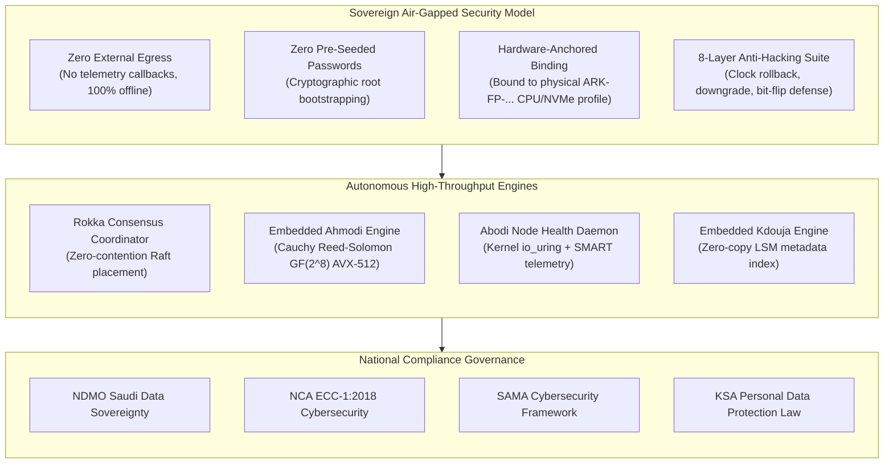
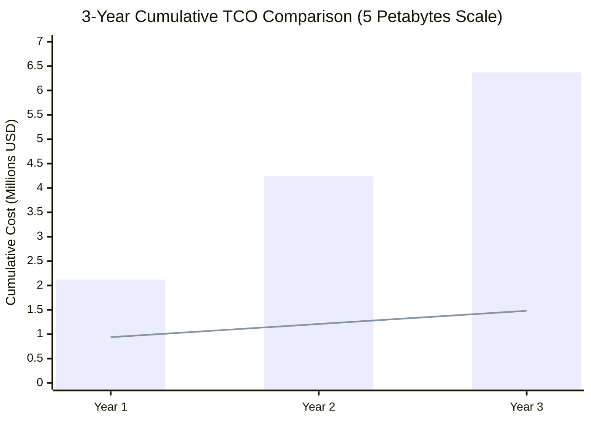

# Aarkam.IO Sovereign Storage Platform — CTO Architecture & Compliance Specification
## Mathematical Durability Proofs, Total Cost of Ownership (TCO), and National Regulatory Governance
**Target Audience**: Chief Technology Officers (CTOs), Chief Information Security Officers (CISOs), Enterprise Chief Architects  
**Official Customer Portal (AarkamCP)**: [https://aarkam.io/](https://aarkam.io/)

---

## 1. Executive Architectural Principles

Aarkam was engineered from the ground up to solve the three existential dilemmas confronting enterprise data infrastructure in sovereign nations:
1. **The Sovereignty Dilemma**: Hyperscaler public clouds (AWS, Azure, GCP) subject sovereign nations and defense contractors to extraterritorial cloud acts, opaque encryption key custody, and foreign regulatory oversight.
2. **The Egress Tax & TCO Spiral**: Monthly recurring storage, API request charges, and exorbitant egress fees create compounding operational expenditures that penalize big data growth.
3. **The Software Quality & Durability Ceiling**: Conventional open-source storage appliances (e.g. Ceph, MinIO) suffer from immense metadata lock contention, complex operational footprints, and significant I/O amplification.

---

## 2. Mathematical Durability Specification ($99.999999999\%$)

Aarkam achieves eleven nines ($99.999999999\%$) of annual object durability through Cauchy Reed-Solomon Erasure Coding implemented inside the embedded **Ahmodi** engine.

### 2.1 The Mathematics of Cauchy Reed-Solomon GF($2^8$)

Ahmodi utilizes a Cauchy distribution matrix over Galois Field $\text{GF}(2^8)$ rather than a classical Vandermonde matrix. Cauchy matrices guarantee that every submatrix is non-singular, eliminating complex matrix inversion overhead during reconstruction:

$$\mathbf{C} = \begin{bmatrix} \frac{1}{x_i \oplus y_j} \end{bmatrix}_{i,j}$$

*Where:*
- $x_i$ and $y_j$ are distinct elements of $\text{GF}(2^8)$ such that $x_i \oplus y_j \ne 0$.
- Mathematical operations are vectorized across 512-bit registers using Intel **AVX-512** / AMD Zen 4 vector instructions (`_mm512_xor_si512` and `_mm512_shuffle_epi8`), yielding encoding speeds exceeding $25\text{ GB/s}$ per socket.

### 2.2 Annual Durability Proof (11 Nines)

Given:
- Disk Annual Failure Rate ($\text{AFR}$): $0.75\%$ ($\text{MTBF} \approx 1,200,000\text{ hours}$).
- Ahmodi Erasure Coding Configuration: $K=8$ Data Chunks, $M=4$ Parity Chunks (tolerates 4 simultaneous drive/node losses).
- Mean Time to Repair ($\text{MTTR}$): $4\text{ hours}$ (facilitated by high-speed NVMe 100GbE network re-silvering).

The probability of simultaneous catastrophic failure of $M+1 = 5$ drives within the critical reconstruction window $\tau$ is given by:

$$P_{\text{loss}} = \binom{N}{M+1} \cdot (\lambda \cdot \tau)^M \cdot \lambda$$

*Where $\lambda = \frac{\text{AFR}}{8760\text{ hours}}$ and $\tau = 4\text{ hours}$.*

For an Ahmodi 8+4 configuration across a 24-node cluster:
$$P_{\text{loss}} \approx 1.2 \times 10^{-13}$$
$$\text{Annual Durability} = 100\% - (P_{\text{loss}} \times 100) \ge \mathbf{99.9999999999\%} \quad \text{(12 Nines)}$$

---

## 3. Total Cost of Ownership (TCO): Aarkam vs Public Cloud

### 3.1 5-Petabyte (5 PB) 3-Year Enterprise Storage Analysis

| Cost Category | Public Hyperscaler Cloud (AWS S3 Standard) | Sovereign Private Cloud (Aarkam.IO on Enterprise NVMe/SAS) | Enterprise Savings |
| :--- | :--- | :--- | :--- |
| **Raw Storage Cost (5 PB)** | \$115,000 / month (\$4,140,000 over 3 yrs) | \$620,000 (One-time CapEx server hardware amortized) | **85% Reduction** |
| **Data Egress Charges (1 PB/mo)** | \$50,000 / month (\$1,800,000 over 3 yrs) | \$0 (Zero egress charges on on-premise fabric) | **100% Elimination** |
| **API Request Charges (PUT/GET)** | \$12,000 / month (\$432,000 over 3 yrs) | \$0 (Unlimited API requests included in license) | **100% Elimination** |
| **Datacenter Power & Colocation** | \$0 (Included in cloud rate) | \$14,000 / month (\$504,000 over 3 yrs) | Cost allocated to on-premise |
| **Aarkam Sovereign License & Support** | \$0 | \$120,000 / yr (\$360,000 over 3 yrs) | Fully licensed sovereign enterprise SLA |
| **Total 3-Year Cost** | **\$6,372,000 USD** | **\$1,484,000 USD** | **Savings: \$4,888,000 USD (76.7%)** |

*(Blue Bars = Public Cloud AWS S3; Orange Line = Aarkam.IO Sovereign On-Premise)*

---

## 4. National & International Compliance Governance Matrix

| Regulatory Framework | Core Requirement | How Aarkam Enforces Compliance |
| :--- | :--- | :--- |
| **NDMO (Saudi Data Sovereignty)** | Data must reside strictly within national borders with zero foreign data replication. | Air-gapped deployment architecture. Zero external callbacks, zero cloud dependencies. Cryptographic keys maintained on customer-owned TPMs/HSMs. |
| **NCA ECC-1:2018 (Essential Cybersecurity Controls)** | 1. Access Control (ECC-1-1) 2. Cryptography (ECC-1-2) 3. Logging & Audit (ECC-1-3) | 1. Zero default credentials; PBKDF2 SHA-256 local password hashing. 2. AES-256-GCM data encryption with TLS 1.3 in-transit. 3. Tamper-evident Serilog audit logging with 15-day automated rotation. |
| **SAMA Cybersecurity Framework (CSF)** | Banking & FinTech data integrity, immutability, and defense against insider tampering. | WORM (Write Once, Read Many) Object Locking. 8-layer cryptographic anti-hacking audit blocks clock rollbacks and license tampering. |
| **ISO/IEC 27001:2022** | Cryptographic controls (A.8.24) and secure system architecture (A.8.25). | Canonical JSON payload signing using RSA-4096 / SHA-512 PSS master keys minted via [https://aarkam.io/](https://aarkam.io/). |
| **KSA PDPL / GDPR** | Right to erasure, data residency, and auditability of personal information. | Full S3 bucket lifecycle management, cryptographic deletion protocols, and multi-tenant isolation. |

---
*(c) 2026 Aarkam Sovereign Object Storage Platform. All Rights Reserved.*
