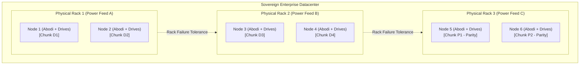
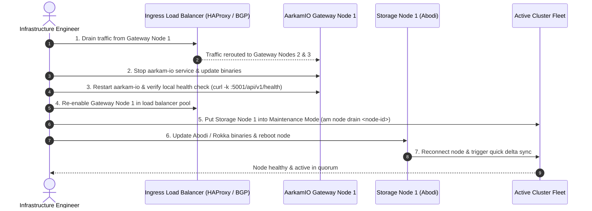
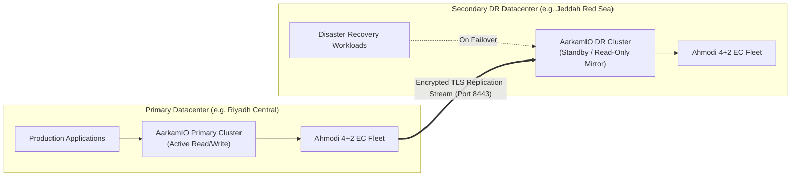

# Aarkam.IO Sovereign Storage Platform — COO Operations & Disaster Recovery Runbook
## Business Continuity, SLA Commitments, Fault-Domain Resilience & Multi-Datacenter DR
**Target Audience**: Chief Operating Officers (COOs), VP of Infrastructure, Site Reliability Engineers (SREs), Incident Commanders  
**Official Customer Portal (AarkamCP)**: [https://aarkam.io/](https://aarkam.io/)

---

## 1. High-Availability (HA) Commitments & Operational SLAs

The Aarkam platform provides enterprise operational continuity backed by mathematical fault tolerance:

| Service Level Agreement (SLA) | Starter Sovereign Pod | Enterprise Standard Cluster | Mission-Critical Multi-DC Cloud |
| :--- | :--- | :--- | :--- |
| **Availability Guarantee** | **99.9%** (8.7 hrs downtime/yr) | **99.99%** (52 mins downtime/yr) | **99.999%** (< 5 mins downtime/yr) |
| **Recovery Point Objective (RPO)** | $\text{RPO} = 0$ (Zero Data Loss) | $\text{RPO} = 0$ (Zero Data Loss) | $\text{RPO} = 0$ (Synchronous) / $\text{RPO} \le 1\text{s}$ (Async) |
| **Recovery Time Objective (RTO)** | $\text{RTO} \le 10\text{ seconds}$ | $\text{RTO} \le 3\text{ seconds}$ | $\text{RTO} \le 1\text{ second}$ (Automated DNS/BGP Failover) |
| **Fault Tolerance Envelope** | 1 Node / 1 Drive simultaneously | 2 Nodes / 2 Drives simultaneously | 4 Nodes / Entire Datacenter Rack |

---

## 2. Fault-Domain Hierarchy & Automated Self-Healing

The embedded **Ahmodi** Cauchy Reed-Solomon engine enforces strict physical failure-domain isolation:



### 2.1 Automated Failure Responses

1. **Drive Degradation or Failure**:
   - **Abodi** detects SMART read errors or sudden block offline events.
   - It raises a drain notification to **Rokka**.
   - **Ahmodi** automatically begins background re-silvering of affected chunks to free disks on healthy nodes.
   - S3 client read/write operations continue with zero interruption and zero perceptible latency degradation.
2. **Node Offline / Power Outage**:
   - Rokka consensus heartbeat (Port 9100) detects node absence within 150 milliseconds.
   - If the node is a Raft Follower, quorum is maintained and the cluster remains fully operational.
   - If the node is the Raft Leader, an election completes in $< 500\text{ ms}$, electing a new leader transparently.
   - If the node remains offline for $> 15\text{ minutes}$, Ahmodi triggers full fleet re-balancing.
3. **Entire Rack Power Failure**:
   - Because Ahmodi 4+2 distributes data chunks ($D_1-D_4$) and parity chunks ($P_1, P_2$) across separate physical racks, the loss of an entire rack (taking down 2 chunks) is fully absorbed by the 2 remaining parity chunks. Zero data loss; client operations continue uninterrupted.

---

## 3. Zero-Downtime Rolling Upgrades Protocol

Cluster maintenance and software updates must be performed without taking down S3 services:



---

## 4. Multi-Datacenter Asynchronous Disaster Recovery (Active-Passive / Active-Active)

For sovereign cloud and national infrastructure disaster recovery, Aarkam provides cross-region asynchronous bucket replication:



### 4.1 Configuring Cross-Region Replication Policy

Replication policies are configured via the AarkamIO CLI or Admin REST API:

```bash
# Create replication target endpoint binding
am replication target add \
  --name "JEDDAH-DR-SITE" \
  --endpoint "https://dr.storage.aarkam.sa:8443" \
  --access-key "AKIA_DR_REPLICATION_USER" \
  --secret-key "SEC_KEY_XXXXXXXXXXXXXXXXXXXX"

# Bind bucket to continuous async replication stream
am replication policy create \
  --source-bucket "sovereign-financial-records" \
  --target "JEDDAH-DR-SITE" \
  --target-bucket "sovereign-financial-records-dr" \
  --replicate-deletes false \
  --bandwidth-limit-mb 500
```

### 4.2 Disaster Recovery Failover Checklist

In the catastrophic event that the Primary Datacenter goes permanently dark:
1. **Declare Disaster**: Incident Commander authorizes DR activation.
2. **Promote DR Target**:
   ```bash
   am replication promote --bucket "sovereign-financial-records-dr"
   ```
3. **Switch DNS / BGP Anycast**: Point global S3 endpoint (`s3.storage.aarkam.sa`) to the secondary datacenter VIP.
4. **Resume Client Workloads**: Application traffic automatically lands on the promoted cluster within $< 15\text{ seconds}$.

---

## 5. Capacity Forecasting & Incident Escalation Matrix

### 5.1 Storage Capacity Watermarks

| Capacity Threshold | System Reaction | Operator Action Required |
| :--- | :--- | :--- |
| **70% Utilized (Normal)** | Informational telemetry logged | Routine capacity planning review. |
| **80% Utilized (Warning)** | Yellow warning banner in Web UI; daily email alert | Plan storage node expansion or enable lifecycle pruning. |
| **88% Utilized (Critical)** | High-priority SMS / PagerDuty alert | Urgent addition of storage nodes or new NVMe drives. |
| **95% Utilized (Emergency)** | Automatic write-throttling on low-priority buckets | Strict emergency freeze: object writes restricted to root admin. |

### 5.2 Incident Escalation Contacts

- **Internal Enterprise SRE Team**: Tier-1 Response (24x7x365).
- **Aarkam Enterprise Support Portal**: Open high-priority tickets directly at **[https://aarkam.io/Administration/TehcnicalSupport](https://aarkam.io/Administration/TehcnicalSupport)**.
- **Critical Phone Hotline**: Referenced in your enterprise commercial SLA agreement.

---
*(c) 2026 Aarkam Sovereign Object Storage Platform. All Rights Reserved.*
