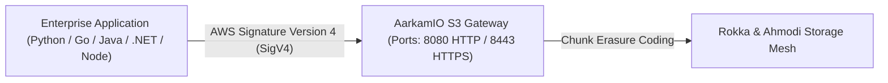

# Aarkam.IO Sovereign Storage Platform — Application Support & S3 SDK Guide
## AWS S3 API Compatibility, SigV4 Authentication, High-Performance Streaming & Multi-Language SDKs
**Target Audience**: Application Developers, Software Engineers, DevOps Specialists, Solutions Architects  
**Official Customer Portal (AarkamCP)**: [https://aarkam.io/](https://aarkam.io/)

---

## 1. AWS S3 API Compatibility Specification

The **AarkamIO S3 Gateway** implements full protocol compliance with the standard Amazon Simple Storage Service (S3) REST API:



### Supported S3 Operations

| Category | S3 API Action | Implementation Details in AarkamIO |
| :--- | :--- | :--- |
| **Bucket Operations** | `CreateBucket`, `DeleteBucket`, `ListBuckets`, `HeadBucket` | Multi-tenant bucket namespaces with granular quota enforcement. |
| **Object Operations** | `PutObject`, `GetObject`, `DeleteObject`, `HeadObject` | Streaming zero-copy I/O with SHA-256 integrity verification. |
| **Multi-Part Uploads** | `CreateMultipartUpload`, `UploadPart`, `CompleteMultipartUpload`, `AbortMultipartUpload` | Supports objects up to **5 Terabytes** in size with concurrent chunk ingestion. |
| **Security & Access** | `PutBucketPolicy`, `GetBucketPolicy`, `PutBucketAcl` | Granular IAM policies, bucket access control lists, and tenant isolation. |
| **Immutability (WORM)** | `PutObjectRetention`, `PutObjectLegalHold` | Regulatory WORM (Write Once, Read Many) retention compliance. |
| **Object Versioning** | `PutBucketVersioning`, `ListObjectVersions` | Continuous object versioning with non-destructive soft deletes. |

---

## 2. Authentication: AWS Signature Version 4 (SigV4)

All incoming HTTP requests to the AarkamIO S3 Gateway are authenticated using **AWS Signature Version 4 (SigV4)**:
- Algorithm: `AWS4-HMAC-SHA256`
- Signed Headers: Mandatory `host`, `x-amz-date`, and `x-amz-content-sha256`.
- Service Name: `s3`
- Default Region: `sa-central-1` (or your sovereign datacenter region configured in `appsettings.json`).

---

## 3. Multi-Language SDK Integration Examples

### 3.1 Python Integration (`boto3`)

Install prerequisite:
```bash
pip install boto3 botocore
```

Production Python Client:
```python
import os
import boto3
from botocore.client import Config

# Initialize Aarkam Sovereign S3 Client
s3_client = boto3.client(
    's3',
    endpoint_url='https://storage.aarkam.internal:8443',
    aws_access_key_id=os.getenv('AARKAM_ACCESS_KEY', 'AKIA_PROD_APP01'),
    aws_secret_access_key=os.getenv('AARKAM_SECRET_KEY', 'SEC_KEY_PROD_SECRET_XYZ'),
    region_name='sa-central-1',
    verify=False,  # Set to path of internal CA bundle for production TLS
    config=Config(
        signature_version='s3v4',
        retries={'max_attempts': 5, 'mode': 'standard'},
        s3={'addressing_style': 'path'}  # Path-style addressing supported
    )
)

# 1. Create a Bucket
bucket_name = "enterprise-documents"
s3_client.create_bucket(Bucket=bucket_name)

# 2. Upload an Object with Metadata
payload = b"Top Secret Sovereign Analytical Data"
s3_client.put_object(
    Bucket=bucket_name,
    Key="reports/2026/q3_audit.pdf",
    Body=payload,
    ContentType="application/pdf",
    Metadata={"classification": "sovereign-confidential", "compliance": "NDMO-Level-4"}
)

# 3. Generate a Presigned Download URL (Expires in 15 minutes)
presigned_url = s3_client.generate_presigned_url(
    'get_object',
    Params={'Bucket': bucket_name, 'Key': "reports/2026/q3_audit.pdf"},
    ExpiresIn=900
)
print(f"Generated Secure Presigned URL: {presigned_url}")
```

---

### 3.2 Go Integration (`aws-sdk-go-v2`)

Install dependencies:
```bash
go get github.com/aws/aws-sdk-go-v2
go get github.com/aws/aws-sdk-go-v2/service/s3
go get github.com/aws/aws-sdk-go-v2/credentials
```

Production Go Implementation:
```go
package main

import (
	"bytes"
	"context"
	"crypto/tls"
	"fmt"
	"net/http"
	"os"

	"github.com/aws/aws-sdk-go-v2/aws"
	"github.com/aws/aws-sdk-go-v2/credentials"
	"github.com/aws/aws-sdk-go-v2/service/s3"
)

func main() {
	customTransport := &http.Transport{
		TLSClientConfig: &tls.Config{InsecureSkipVerify: true}, // Replace with internal CA root
	}
	httpClient := &http.Client{Transport: customTransport}

	cfg := aws.Config{
		Region:       "sa-central-1",
		Credentials:  credentials.NewStaticCredentialsProvider("AKIA_PROD_APP01", "SEC_KEY_PROD_SECRET_XYZ", ""),
		HTTPClient:   httpClient,
		BaseEndpoint: aws.String("https://storage.aarkam.internal:8443"),
	}

	client := s3.NewFromConfig(cfg, func(o *s3.Options) {
		o.UsePathStyle = true
	})

	// Upload object
	data := []byte("Sovereign Infrastructure Pipeline Payload")
	_, err := client.PutObject(context.TODO(), &s3.PutObjectInput{
		Bucket:      aws.String("telemetry-logs"),
		Key:         aws.String("node01/health.json"),
		Body:        bytes.NewReader(data),
		ContentType: aws.String("application/json"),
	})
	if err != nil {
		fmt.Printf("Upload failed: %v\n", err)
		os.Exit(1)
	}

	fmt.Println("Object uploaded successfully to AarkamIO Sovereign S3 Gateway!")
}
```

---

### 3.3 C# / .NET Integration (`AWSSDK.S3`)

Install NuGet package:
```bash
dotnet add package AWSSDK.S3
```

Production C# Client:
```csharp
using System;
using System.IO;
using System.Text;
using System.Threading.Tasks;
using Amazon.S3;
using Amazon.S3.Model;

namespace Aarkam.SampleClient;

public class Program
{
    public static async Task Main(string[] args)
    {
        var config = new AmazonS3Config
        {
            ServiceURL = "https://storage.aarkam.internal:8443",
            ForcePathStyle = true,
            AuthenticationRegion = "sa-central-1"
        };

        using var client = new AmazonS3Client("AKIA_PROD_APP01", "SEC_KEY_PROD_SECRET_XYZ", config);

        // Put Object
        var putRequest = new PutObjectRequest
        {
            BucketName = "defense-assets",
            Key = "archive/satellite_feed.bin",
            InputStream = new MemoryStream(Encoding.UTF8.GetBytes("Binary Telemetry Buffer")),
            ContentType = "application/octet-stream"
        };
        putRequest.Metadata.Add("x-amz-meta-retention", "permanent");

        var response = await client.PutObjectAsync(putRequest);
        Console.WriteLine($"Object stored with HTTP ETag: {response.ETag}");
    }
}
```

---

### 3.4 Node.js / TypeScript Integration (`@aws-sdk/client-s3`)

Install SDK:
```bash
npm install @aws-sdk/client-s3
```

Production TypeScript Implementation:
```typescript
import { S3Client, PutObjectCommand, GetObjectCommand } from "@aws-sdk/client-s3";
import { NodeHttpHandler } from "@smithy/node-http-handler";
import * as https from "https";

const s3Client = new S3Client({
  endpoint: "https://storage.aarkam.internal:8443",
  region: "sa-central-1",
  credentials: {
    accessKeyId: process.env.AARKAM_ACCESS_KEY || "AKIA_PROD_APP01",
    secretAccessKey: process.env.AARKAM_SECRET_KEY || "SEC_KEY_PROD_SECRET_XYZ",
  },
  forcePathStyle: true,
  requestHandler: new NodeHttpHandler({
    httpsAgent: new https.Agent({ rejectUnauthorized: false }), // Custom CA in production
  }),
});

async function uploadFile() {
  const command = new PutObjectCommand({
    Bucket: "portal-assets",
    Key: "branding/logo.svg",
    Body: "<svg>...</svg>",
    ContentType: "image/svg+xml",
  });

  await s3Client.send(command);
  console.log("Successfully uploaded to Aarkam Sovereign S3 storage!");
}

uploadFile().catch(console.error);
```

---

## 4. Multi-Part Upload Performance Optimization

For large objects ($> 100\text{ MB}$ up to $5\text{ TB}$), applications must utilize Multi-Part Uploads to maximize parallel throughput across 25GbE / 100GbE network fabrics:

### Recommended Multi-Part Parameters:
- **Part Size**:
  - Minimum Part Size: $5\text{ MB}$ (Standard AWS S3 requirement).
  - Recommended Part Size: **$32\text{ MB} - 64\text{ MB}$** (Optimized for Ahmodi Cauchy erasure coding chunk geometry).
- **Concurrency**:
  - Recommended Concurrency: **8–16 simultaneous part uploads** per client worker.
  - Saturated throughput: Exceeds $2.5\text{ GB/sec}$ per ingestion gateway.

---

## 5. Command-Line Administration with MinIO Client (`mc`)

The standard enterprise MinIO Client (`mc`) is fully compatible with AarkamIO:

```bash
# 1. Add AarkamIO alias
mc alias set aarkam https://storage.aarkam.internal:8443 AKIA_PROD_APP01 SEC_KEY_PROD_SECRET_XYZ --insecure

# 2. List Buckets
mc ls aarkam/

# 3. Create a Bucket with Object Locking Enabled
mc mb --with-lock aarkam/governance-records

# 4. Mirror a local directory to AarkamIO at high speed
mc mirror --parallel 16 /mnt/data/backups/ aarkam/governance-records/backups/
```

---
*(c) 2026 Aarkam Sovereign Object Storage Platform. All Rights Reserved.*
